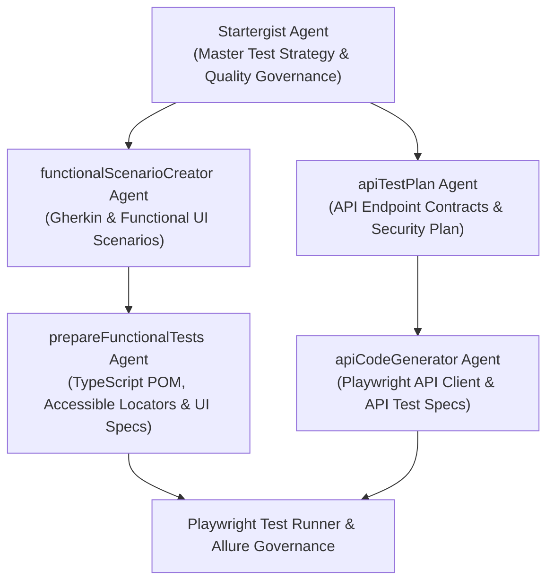

<!-- Author: Raveen -->

# Enterprise Playwright Automation Framework

This project is a Playwright-based test automation framework designed to help teams validate web applications quickly, consistently, and with clear reporting. It combines browser automation, reusable page objects, test data management, traceability tracking, and quality gates in a simple enterprise-ready structure.

## What this product does

- Automates browser-based test flows for web applications
- Provides reusable page objects for maintainable tests
- Supports login, smoke, and functional validation scenarios
- Keeps test data and environment configuration centralized
- Tracks requirements, scenarios, and automation status in one place
- Enforces linting and TypeScript checks before execution

## Who this is for

- New users onboarding to the project
- QA engineers and automation engineers
- Developers validating application behavior
- Teams who need a simple and structured automation setup

By the end of this guide, you should be able to:

- Set up the project locally
- Understand the folder structure
- Prepare the required environment and test data
- Run the smoke workflow
- Review results and reports
- Troubleshoot common issues

---

## Prerequisites / Before You Start

### System requirements

| Requirement      | Recommended                  |
| ---------------- | ---------------------------- |
| Operating System | Windows 10+, macOS, or Linux |
| Node.js          | 22.x (matches CI)            |
| Package Manager  | npm                          |
| Browser Support  | Chromium, Firefox, WebKit    |
| Memory           | 8 GB RAM or more             |
| Disk Space       | At least 5 GB free           |

### Tools and access needed

- Git installed locally
- Node.js and npm installed
- Access to the project repository
- Access to the application or local app URL
- Optional: credentials for login flows if the application requires them
- Optional: CI/CD access for pipeline execution

### Installation and setup

1. Clone the repository:

   ```bash
   git clone <repository-url>
   cd <repository-folder>
   ```

2. Install dependencies:

   ```bash
   npm ci
   ```

3. Install Playwright browsers:

   ```bash
   npx playwright install --with-deps
   ```

4. Validate the project before using it:

   ```bash
   npm run quality-gate
   ```

### Folder structure overview

```text
.
├── .github/
│   ├── agents/
│   ├── prompts/
│   └── workflows/
│       └── playwright.yml
├── docs/
│   ├── api-test-plan.md
│   ├── functional-test-plan.md
│   ├── traceability-tracker.md
│   └── test-strategy-template.md
├── fixtures/
│   └── test-data.ts
├── locators/
│   └── common.locators.ts
├── pages/
│   ├── base.page.ts
│   ├── login.page.ts
│   └── dashboard.page.ts
├── public/
│   ├── index.html
│   └── login.html
├── scripts/
│   ├── analyze-impact.mjs
│   ├── analyze-impact.test.mjs
│   ├── target-policy.test.mjs
│   ├── traceability.mjs
│   ├── validate-traceability.mjs
│   └── validate-traceability.test.mjs
├── tests/
│   ├── functional/
│   │   ├── smoke.spec.ts
│   │   ├── auth.spec.ts
│   │   ├── security.spec.ts
│   │   └── boundary.spec.ts
│   └── apiTests/
│       └── api.spec.ts
├── utils/
│   ├── auth.ts
│   └── api-client.ts
├── .githooks/
│   └── pre-commit
├── eslint.config.mjs
├── package.json
├── playwright.config.ts
├── tsconfig.json
├── LICENSE
├── CONTRIBUTING.md
├── CODE_OF_CONDUCT.md
├── SECURITY.md
├── README.md
├── UserGuide.md
├── .traceability-events.json
└── .gitignore
```

---

## AI Agents & Dual-Track Automation Architecture

This repository incorporates an AI Agent ecosystem architected into two specialized validation tracks anchored by a master strategy engine:



### 1. Functional & UI Track

- **`Startergist`** ([.github/agents/startergist.agent.md](.github/agents/startergist.agent.md)): Produces enterprise quality strategies, risk priorities, and governance metrics.
- **`functionalScenarioCreator`** ([.github/agents/functionalScenarioCreator.agent.md](.github/agents/functionalScenarioCreator.agent.md)): Generates traceable Gherkin specifications and detailed UI test cases.
- **`prepareFunctionalTests`** ([.github/agents/prepareFunctionalTests.agent.md](.github/agents/prepareFunctionalTests.agent.md)): Translates functional designs into Playwright Page Objects (`pages/`) and functional test specs (`tests/functional/smoke.spec.ts`, `tests/functional/auth.spec.ts`, `tests/functional/security.spec.ts`, `tests/functional/boundary.spec.ts`).

### 2. API Automation Track

- **`apiTestPlan`** ([.github/agents/apiTestPlan.agent.md](.github/agents/apiTestPlan.agent.md)): Analyzes endpoints and designs contract, negative, and OWASP API Top 10 security test plans.
- **`apiCodeGenerator`** ([.github/agents/apiCodeGenerator.agent.md](.github/agents/apiCodeGenerator.agent.md)): Implements executable Playwright `APIRequestContext` tests and reusable helpers (`utils/api-client.ts`, `tests/apiTests/api.spec.ts`).

---

---

## Quick Start (Close → Prepare → Execute → Report)

### Close

- [ ] Open the repo in a terminal
- [ ] Confirm Node.js 22.x and npm are installed
- [ ] Run `npm ci`
- [ ] Run `npx playwright install --with-deps`
- [ ] Confirm the workspace is ready for execution

Example:

```bash
cd <repository-folder>
npm ci
npx playwright install --with-deps
```

### Prepare

- [ ] Review `playwright.config.ts`
- [ ] Confirm the application URL is reachable
- [ ] Check test data in `fixtures/test-data.ts`
- [ ] Verify environment variables if the app requires them
- [ ] Confirm the app login screen is accessible

Example local URL:

```text
http://127.0.0.1:4173
```

### Execute

Use the main scripts from `package.json`:

```bash
npm run quality-gate
npm run traceability:validate
npx playwright test --project=chromium --reporter=line
```

The supported runtime is Node.js 22.x, recorded in `package.json` and `.nvmrc`; CI uses the same major version. Use `npm ci` to restore the committed lockfile. The static server and Allure CLI are declared development dependencies rather than downloaded implicitly during execution.

The quality gate runs lint, TypeScript, framework regression tests, traceability validation, and `npm audit --audit-level=high`. Traceability checks require each named test to have a requirement ID and one or more scenario IDs, with mappings resolving to their functional/API plan and referenced strategy section. Automated scenarios must have runnable declarations; skipped/fixme-only coverage, missing or mismatched functional plan test targets, and conflicting automation statuses fail. Static string and template-literal titles are supported; dynamic titles and conditional skip/fixme calls require an explicit review and are rejected by the static gate. Functional mappings are maintained in `docs/traceability-tracker.md` and `docs/functional-test-plan.md`; API mappings are maintained in `docs/api-test-plan.md`. API suite results currently cover browser-intercepted mocks, not a live API. Static validation is not execution evidence.

Run `npm run test:framework` for focused traceability, target-policy/API-client, and impact-analysis regression tests. These isolated Node tests do not call a live service. Run `npm run report:generate` to generate an Allure report or `npm run report` to generate and open it. Allure report generation additionally requires Java installed and available on PATH (or through `JAVA_HOME`); the CLI dependency does not install Java. CI currently archives raw Allure results, not rendered Allure reports.

Browser and API-client targets share the central target policy. Malformed configured QA/UAT/production URLs, unsupported protocols, and embedded URL credentials fail explicitly even for local runs. Remote browsers additionally require all dedicated persona credentials; blank or known demo values are rejected without exposing their values.

Before changing a requirement or scenario, run the focused impact scan to locate related plans, tests, POMs, fixtures, utilities, and configuration:

```bash
npm run impact:analyze -- REQ-API-01
npm run impact:analyze -- REQ-API-01 SCN-API-05
npm run impact:analyze -- pages/login.page.ts --json
```

The scan resolves canonical tracker IDs and repository paths, follows static imports/reexports and TypeScript aliases, and identifies reverse-transitive consumers plus their dependencies. Shared execution configuration selects all browser test files. JSON includes technical severity and rationale, modules, scenarios, registered risks, artifacts, document references, strategy sections, test-data review, required actions, validation commands, approval needs, and scan size. Unmatched inputs exit nonzero; no files are modified.

This is conservative file-level analysis: sibling scenarios can be included. Runtime UI/network links, computed dependencies, deleted files, and external requirement systems are not inferred; affected unresolved imports are surfaced for review. Technical severity is not an owner-approved business risk score. Consume the compact signal once, inspect only impacted artifacts, and confirm before material behavior/contract changes, live targets, cross-module expansion, bulk additions, or new thresholds. Production execution is prohibited. Planning agents without execution tools request the report; guidance does not replace human approval.

Update linked documents and metadata together and rerun the gate; semantic documentation synchronization and normalized KPI/trend reporting are not yet automated.

Common commands:

```bash
npm test
npm run test:functional
npm run test:apiTests
npm run test:smoke
npx playwright test tests/functional/smoke.spec.ts --project=chromium --reporter=line
```

### Report

- [ ] Review the terminal output
- [ ] Check screenshots, traces, and failure artifacts
- [ ] Open the report if needed
- [ ] Update the traceability tracker if relevant
- [ ] Share results with stakeholders or teammates

Useful reporting commands:

```bash
npx playwright show-report
npm run report
```

---

## Detailed Workflow Explanation

### Stage 1: Close

Purpose:

- Prepare the local environment
- Install dependencies and browser binaries
- Confirm the workspace is healthy before execution

Expected output:

- Dependencies installed without errors
- Browser engines available for Playwright
- Project ready for tests

Common mistakes:

- Missing Node.js version
- Running commands from the wrong directory
- Skipping browser installation

### Stage 2: Prepare

Purpose:

- Validate configuration and app readiness
- Ensure test inputs match the app under test
- Confirm the environment is stable before automation begins

Expected output:

- Configuration ready
- App URL reachable
- Test data valid and centralized

Common mistakes:

- Using the wrong base URL
- Editing runtime data without checking fixtures
- Starting tests before the app is running

### Stage 3: Execute

Purpose:

- Run the test automation flow
- Validate login and key user journeys
- Detect functional failures early

Expected output:

- Summary in terminal
- Browser outputs and traces
- Pass/fail status for each scenario

Example execution:

```bash
npm run quality-gate
npx playwright test tests/functional/smoke.spec.ts --project=chromium --reporter=line
```

### Stage 4: Report

Purpose:

- Review the outcomes clearly
- Capture evidence for QA or release checkpoints
- Preserve runtime and traceability history

Expected output:

- Pass/fail summary
- Log and report artifacts
- Updated test status records

---

## Troubleshooting

### Dependency installation fails

Confirm Node.js 22.x is active, then rerun `npm ci` and inspect the reported error. Do not bypass peer-dependency checks or regenerate the lockfile as an installation workaround; dependency changes require a reviewed manifest/lockfile update.

### Playwright browsers missing

```bash
npx playwright install --with-deps
```

### App not reachable

- Confirm the app is running
- Check the URL in `playwright.config.ts`
- Use the expected local URL such as `http://127.0.0.1:4173`

### Lint or typecheck fails

```bash
npm run quality-gate
```

Typical fixes:

- Remove unused imports
- Use proper type imports
- Fix config typing issues
- Correct invalid assumptions in selectors or assertions

### Tests fail across browsers only

- Run one browser first for debugging
- Check selectors for browser-specific behavior
- Prefer stable locators and explicit waits

---

## Best Practices

- Keep tests readable and action-based
- Store shared user data in `fixtures/test-data.ts`
- Keep page logic in `pages/`
- Keep reusable utilities in `utils/`
- Keep functional test suites in `tests/functional/`
- Keep API test suites in `tests/apiTests/`
- Run smoke checks before broad regression runs
- Keep report artifacts and traces for failures
- Use a clean, consistent naming pattern for files and scenarios

---

## FAQ

### What is this project for?

This is a Playwright-based automation framework for validating web app behavior with structured test execution and reporting.

### Do I need any special setup?

You need Node.js, npm, Git, and Playwright browsers installed.

### How do I run the smoke test?

```bash
npm run test:smoke
# or: npx playwright test tests/functional/smoke.spec.ts --project=chromium --reporter=line
```

### Where should I update test data?

Use `fixtures/test-data.ts` for shared users and scenario inputs.

### Where do I review results?

Use terminal output, failure screenshots, traces, and the Playwright report viewer.

---

## Support & Contribution

### Getting help

- Review this README
- Check the repo docs and traceability files
- Inspect existing tests and page objects for patterns
- Review error logs and trace artifacts

### Reporting issues

Include:

- problem summary
- steps to reproduce
- command used
- screenshots or logs
- expected vs actual result

### Contributing

1. Create a feature branch
2. Make a focused change
3. Run the quality gate and relevant tests
4. Submit a clear pull request with a concise summary

Example:

```bash
git checkout -b feature/my-change
npm run quality-gate
npx playwright test tests/functional/smoke.spec.ts --project=chromium --reporter=line
```

---

## Documentation index

- [UserGuide.md](UserGuide.md) — user onboarding guide
- [docs/test-strategy-template.md](docs/test-strategy-template.md) — reusable strategy template
- [docs/functional-test-plan.md](docs/functional-test-plan.md) — scoped functional scenarios and automation targets
- [docs/api-test-plan.md](docs/api-test-plan.md) — API scenarios and mock/live evidence boundary
- [docs/traceability-tracker.md](docs/traceability-tracker.md) — canonical scenario mapping and execution status

## CI/CD

GitHub Actions runs from `.github/workflows/playwright.yml`. The quality job runs lint, type checking, and traceability validation before the browser matrix.
